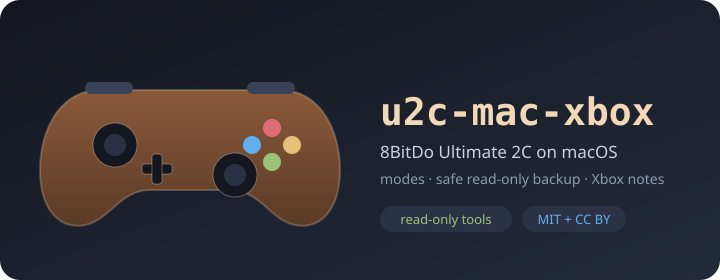

# u2c-mac-xbox

Community notes and **read-only** tools for the **8BitDo Ultimate 2C Wireless** controller: what it looks like to macOS, how to back up its firmware safely, and what is (and is not) possible with Xbox.

> This repo **never writes to your device** and does not distribute firmware. All measurements come from a single unit on macOS 26.6.2 / Apple Silicon. Anything not verified is labeled (see below).

## TL;DR

| Topic | Status |
|---|---|
| Gamepad on a Mac over **Bluetooth** | ✅ Works: `standard` mapping in the browser, 4 axes, 17 buttons, full stick/trigger range `[VERIFIED]` |
| Gamepad over **wired USB-C** or the **2.4G dongle** | ❌ macOS binds no driver to the XInput interface, no gamepad shows up `[VERIFIED]` |
| Firmware backup (controller + dongle) | ✅ Done with the Toolkit's read-only `backup` command, two passes + SHA-256 `[VERIFIED]` |
| Direct USB to Xbox Series S | ⚠️ No known public way; Microsoft authentication is required `[GENERAL KNOWLEDGE]` |
| Remote Play / Greenlight | ⏳ Not tried `[NOT TRIED]` |

## Quick start (Mac)

1. Put the **physical switch on the back to the Bluetooth position** (check the markings on your unit).
2. Pair it in System Settings → Bluetooth.
3. Open `scripts/gamepad-test.html` in a Chromium-based browser, press a button, then move every stick/trigger/button.
4. To see what macOS sees: `bash scripts/inventory.sh` (read-only, output is redacted).

## What this repo does not do

- It does **not write anything** to the device (no firmware, no settings, no HID output reports).
- It does **not distribute** firmware, `.dat` files or backups. Hashes are given only for official files.
- It does **not** explain how to bypass Xbox authentication.

## Docs

| File | Contents |
|---|---|
| [docs/01-modes-and-ids.md](docs/01-modes-and-ids.md) | Modes and USB/BT identifiers |
| [docs/02-macos-status.md](docs/02-macos-status.md) | What works on macOS |
| [docs/03-access-methods.md](docs/03-access-methods.md) | Ways to access the controller, required tools |
| [docs/04-firmware-version.md](docs/04-firmware-version.md) | Finding the firmware version |
| [docs/05-safe-backup.md](docs/05-safe-backup.md) | **Safe backup procedure** |
| [docs/06-firmware-hashes.md](docs/06-firmware-hashes.md) | Known official hashes |
| [docs/07-flash-map.md](docs/07-flash-map.md) | Flash memory map |
| [docs/08-xbox-gip-auth.md](docs/08-xbox-gip-auth.md) | Xbox authentication and options |
| [docs/09-remote-play.md](docs/09-remote-play.md) | Remote Play notes |
| [docs/10-troubleshooting.md](docs/10-troubleshooting.md) | Troubleshooting |
| [docs/11-unverified-claims.md](docs/11-unverified-claims.md) | **Unverified claims** |
| [docs/12-sources.md](docs/12-sources.md) | Sources |

## Evidence labels

`[VERIFIED]` measured on our unit · `[OBSERVED]` seen, may not generalize · `[PER TOOLKIT]` third-party documentation · `[VENDOR CLAIM]` · `[SECONDHAND]` · `[GUESS]` · `[NOT TRIED]` · `[TRIED-FAILED]` · `[UNVERIFIED]`

## Contributing

Want to share your unit's results? See [CONTRIBUTING.md](CONTRIBUTING.md). **Never post serial numbers, MAC addresses or backup files.**

## Disclaimer

Not affiliated with 8BitDo, Microsoft or the projects mentioned. See [DISCLAIMER.md](DISCLAIMER.md).

## License

Code: [MIT](LICENSE). Text: [CC BY 4.0](LICENSE-docs).
